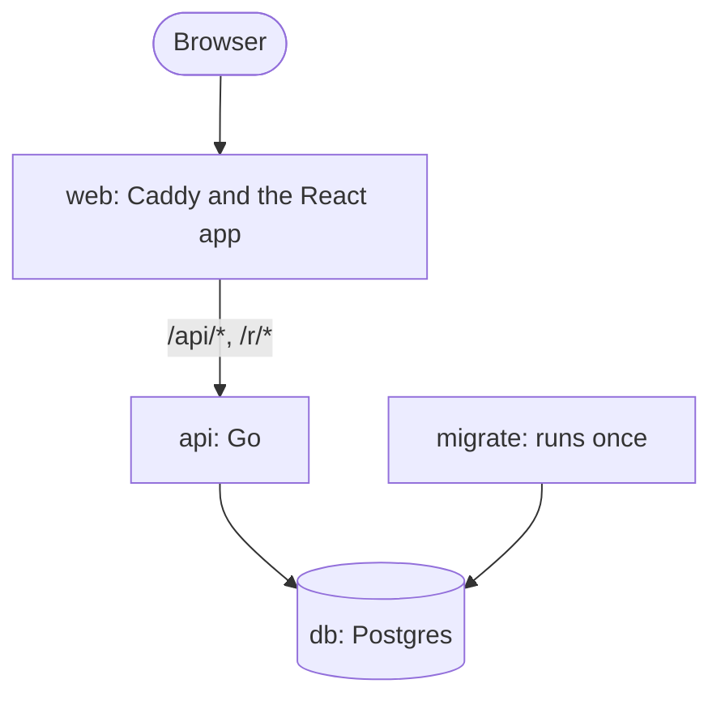
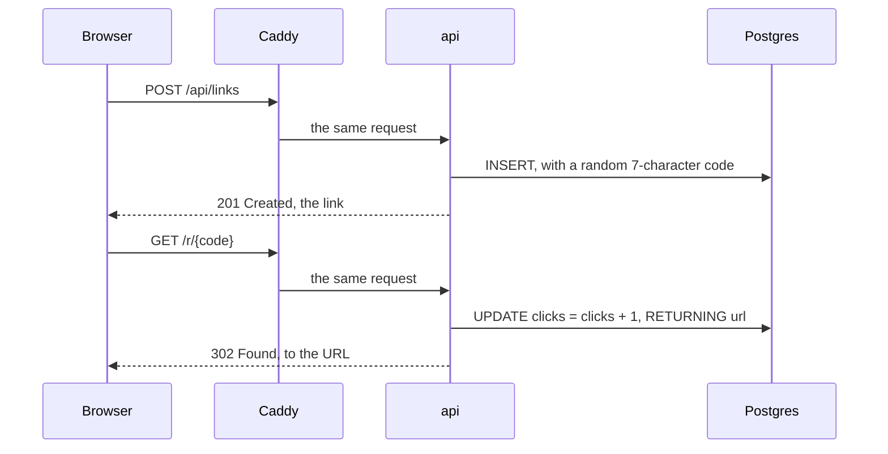

# Architecture

How fullmono's parts fit together. To run it, see the [README](../README.md);
to change it, [CONTRIBUTING.md](CONTRIBUTING.md).

## Containers

Locally, [compose.yaml](../compose.yaml) runs the stack. On a server,
[deploy/compose.yaml](../deploy/compose.yaml) runs the same images, pulled from
GitHub's container registry.

| Container       | Image                | What it does                                                       |
| --------------- | -------------------- | ------------------------------------------------------------------ |
| `db`            | `postgres:18-alpine` | Keeps the links and the admins, in the `db-data` volume            |
| `migrate`       | `fullmono-api`       | Applies the migrations, then exits; the api starts only after it   |
| `api`           | `fullmono-api`       | The JSON api and the redirects, on port 8080 inside the stack      |
| `web`           | `fullmono-web`       | Caddy, serving the built React app and passing the rest to the api |
| `dozzle`, `e2e` |                      | Only on demand: the log viewer and the end-to-end tests            |

`migrate` and `api` are one image: the Go binary takes a command, `migrate`
or none to serve.

## A request's path

Caddy is the only door. Any path that isn't `/api/*` or `/r/*` is a file it
serves itself: `/`, the hashed `/assets/*`, and `/admin`, which has no file,
so it gets `index.html` and the React app routes it in the browser.

Shortening a link, then following it:

## The api's routes

| Method   | Path                      | For    | What it does                                                 |
| -------- | ------------------------- | ------ | ------------------------------------------------------------ |
| `GET`    | `/api/health`             | anyone | Answers 200 while the database does; the healthcheck asks it |
| `GET`    | `/api/links`              | anyone | The 50 newest links                                          |
| `POST`   | `/api/links`              | anyone | Shortens a URL                                               |
| `GET`    | `/r/{code}`               | anyone | Redirects to the code's URL and counts the click             |
| `POST`   | `/api/admin/session`      | anyone | Logs an admin in: the `admin_token` cookie                   |
| `GET`    | `/api/admin/session`      | admins | Who is logged in                                             |
| `DELETE` | `/api/admin/session`      | anyone | Logs out: drops the cookie                                   |
| `GET`    | `/api/admin/links`        | admins | Searches the links, a page at a time                         |
| `DELETE` | `/api/admin/links/{code}` | admins | Deletes a link                                               |
| `GET`    | `/api/admin/stats`        | admins | The totals and the most clicked links                        |

An admin's login is a JWT, signed with `JWT_SECRET`, in an _httpOnly_ cookie:
the browser sends it with every `/api/admin` request, and the page's scripts
can't read it.

## Data

Two tables, which [schema.sql](../apps/api/migrations/schema.sql) shows whole:

- **links**: each short code, its URL and its click count.
- **admins**: who may log in, with a bcrypt hash of each password, never the
  password itself.

They aren't related: a link belongs to nobody.
